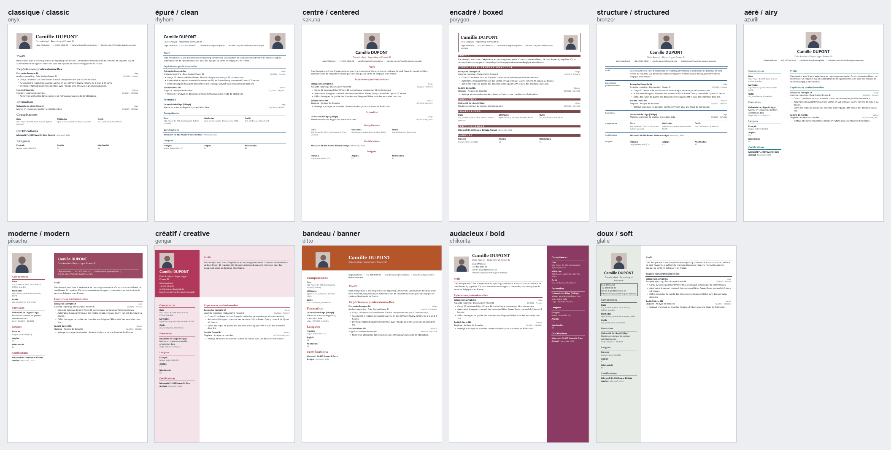

# CV ATS francophone · Claude skill

[Français](README.md) · **English**

A free Claude skill that writes a CV **tailored to each job offer**, **in French or English**, and **readable by applicant tracking systems (ATS)**, following the CV practices of French-speaking countries: **Belgium, France, French-speaking Switzerland, Luxembourg, Quebec and francophone Africa**.



**[Download the skill (ready-to-import ZIP)](https://github.com/melataguia/ats-resume-francophone/releases/latest/download/cv-ats-francophone.zip)** · 2-minute setup [below](#installation).

## Why this skill
Most CV skills follow US or UK norms. This one starts from the realities of French-speaking countries: CEFR language levels (essential in Belgium, Switzerland and Luxembourg), photo and date of birth depending on the country, Swiss residence permits, letter-size paper and anti-discrimination rules in Quebec, equivalences for foreign degrees.

Many employers in these countries (multinationals, EU institutions, international organisations, tech, consulting) ask for an English CV. The skill writes it in English too, while keeping the practices of the job's country: an English CV for Geneva is not an American resume.

## What it does
1. **Gives an honest assessment** of how your profile fits the offer (percentage, strengths, gaps, recommendation).
2. **Detects the company's ATS** from the job link (Workday, SmartRecruiters, Taleo, iCIMS, Greenhouse, Lever, Teamtailor, Recruitee, SuccessFactors...) and applies its rules.
3. **Chooses the CV language**: the one the employer asks for, otherwise the offer's language. In English, it translates job and degree titles faithfully (original degree title in brackets), contract types and places.
4. **Extracts the offer's keywords** and uses them in your CV, **only when they are true**.
5. **Builds an ATS CV** in Word (.docx) and text PDF: one column, no tables, no text boxes, dates as MM/YYYY.
6. **Builds a designed version** (optional) on 11 templates inspired by [Reactive Resume](https://rxresu.me), to send by e-mail or bring to an interview.
7. **Tests how an ATS reads the CV**: name, e-mail, phone, every job, every company, every date. If something fails, it fixes it before delivering.
8. **Gives a keyword score** (for example 10/12, 83 %) and an honest list of what is missing.
9. Writes the **cover letter** on request, in French or English.

It never invents experience, degrees, figures or language levels.

## Installation

### Claude.ai (web, desktop, mobile)
1. Download [cv-ats-francophone.zip](https://github.com/melataguia/ats-resume-francophone/releases/latest/download/cv-ats-francophone.zip), the ZIP of the latest version.
2. In Claude's settings, check that code execution is turned on, then, in the **Skills** section, upload the ZIP as is, without unzipping it.
3. Turn the skill on.

All versions and what changed: [Releases](https://github.com/melataguia/ats-resume-francophone/releases).

### Claude Code
```bash
git clone https://github.com/melataguia/ats-resume-francophone.git
cp -r ats-resume-francophone/skills/cv-ats-francophone ~/.claude/skills/
```
Script requirements: Node.js (with the `docx` package, installed by the skill when needed), Python 3 with `python-docx`, poppler (`pdftotext`) to test a PDF, and LibreOffice or Word to export PDFs (optional).

## Usage
Attach your current CV (or fill in `references/profil_modele.md` once), paste the job offer or its link, and ask, for example:
- "Tailor my CV to this job in Brussels, in English."
- "Will my CV get through the ATS? Here is the link to the offer."
- "Write a CV and a cover letter for this job in Geneva."
- "This company in Luxembourg wants an English CV: write it."
- "Also make a designed version with the creative template."

Tip: keep your full profile in one file. The skill picks what matters for each offer, in the language you need.

## Designed version templates
The skill suggests a template based on the sector and the country (a photo is expected in Switzerland and avoided in Quebec). You can also pick one by name, descriptive or original:

| Name | Original name | Layout | Good for |
|---|---|---|---|
| classic | onyx | 1 column | Banking, finance, audit, legal, public sector |
| clean | rhyhorn | 1 column | Tech, data, engineering, consulting |
| centered | kakuna | 1 column | Junior profiles, teaching, healthcare |
| boxed | porygon | 1 column | Hospitality, retail, logistics |
| structured | bronzor | 1 column | Senior profiles, institutions, 2-page CVs |
| airy | azurill | 2 columns | Tech, product, project management |
| modern | pikachu | 2 columns | Consulting, HR, training |
| creative | gengar | 2 columns | Marketing, communication, sales |
| banner | ditto | 2 columns | Architecture, design, creative jobs |
| bold | chikorita | 2 columns | Marketing, branding, events |
| soft | glalie | 2 columns | Environment, NGOs, non-profit |

Never upload the designed version to an ATS portal: portals get the ATS version.

## Examples
Fictitious profile of Camille DUPONT, Data Analyst in Liège:

| Source file | Result |
|---|---|
| `exemples/cv_content_exemple.json` + `keywords_exemple.txt` | `CV_Camille_DUPONT_Exemple_ATS.pdf` (French) |
| `exemples/cv_content_example_en.json` + `keywords_example_en.txt` | `CV_Camille_DUPONT_Example_ATS_EN.pdf` (English) |
| `exemples/cv_content_exemple.json` (modern template) | `CV_Camille_DUPONT_Exemple_Design.pdf` |

Test results:
- French CV: keywords 9/11 (82 %), missing Tableau and Azure, ATS read test passed.
- English CV: keywords 10/12 (83 %), missing Tableau and Azure, ATS read test passed.

## Contents
```
skills/cv-ats-francophone/        the skill (this is the folder inside the ZIP)
├── SKILL.md                      instructions for Claude
├── references/
│   ├── ats_rules.md              ATS rules, ATS detection, keywords, content format
│   ├── pays_francophones.md      CV practices by country, and English CVs in these countries
│   ├── style_redaction.md        writing style in French and English, filler words to avoid, job titles
│   ├── modeles_design.md         the 11 designed-version templates and how to choose
│   └── profil_modele.md          full profile template
└── scripts/
    ├── build_ats_cv.js           builds the ATS CV (.docx)
    ├── build_design_cv.js        builds the designed version (.docx) on a template
    └── ats_check.py              ATS read test + keyword score
exemples/                         fictitious profile in French and English, keywords, generated CVs, template preview
.github/                          "Country practice to fix" issue form and automatic releases
```
The skill's instructions and reference files are written in French; Claude follows them in any language and answers in yours.

## Contributing
Practices change and vary by sector. Do you recruit in Senegal, Cameroon, Ivory Coast, Geneva or Montreal and see a rule to fix or add? [Report a country practice to fix](https://github.com/melataguia/ats-resume-francophone/issues/new?template=usage-pays.yml): a short form, in French or English. Pull requests on `references/pays_francophones.md` are welcome too, with a source if possible.

Did you see an ATS misread a CV made with this skill? Describe the case, without personal data, in an [issue](https://github.com/melataguia/ats-resume-francophone/issues/new).

## Disclaimer
This skill helps present a real career clearly. It does not guarantee an interview: ATS tools and recruiters each have their own criteria. Country practices are common practice, not legal rules, unless stated otherwise.

## Credits
The designed version's layouts follow the templates of [Reactive Resume](https://rxresu.me) by Amruth Pillai (MIT licence). The code in this repository is written for Word and does not reuse Reactive Resume's code.

## Author
Made by **Bidias Melataguia**, founder of The Analyst. MIT licence: free to use, modify and share.
